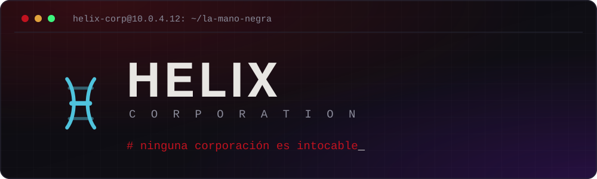
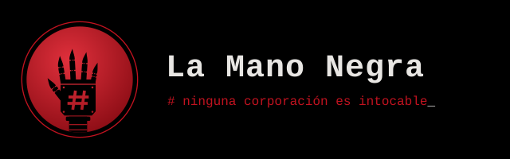

<div align="center">



<br/>
<br/>


<p>
  <a href="#qué-es-esto">Qué es</a> &nbsp;·&nbsp;
  <a href="#la-red">La red</a> &nbsp;·&nbsp;
  <a href="#cómo-jugar">Cómo jugar</a> &nbsp;·&nbsp;
  <a href="#el-universo-narrativo">Universo</a> &nbsp;·&nbsp;
  <a href="#estructura-del-repositorio">Estructura</a> &nbsp;·&nbsp;
  <a href="#sumar-una-máquina">Contribuir</a>
</p>

</div>

```
$ ssh helix-corp@10.0.4.12
Last login: Mon Sep 28 03:14:07 -0300 from unknown
Connecting to HELIX-CORP internal network...

[!] Credenciales válidas, pero no emitidas por HELIX Corp.
[!] Origen del acceso: LA MANO NEGRA
[!] Este repositorio es el resultado de esa intrusión.

Cargando helix-corporation... listo.
```


## Qué es esto

<div align="justify">

Un repositorio de **laboratorios de ciberseguridad**: explotación de vulnerabilidades, escalada de privilegios y categorías afines, cada uno empaquetado en **Docker** para levantarse y resetearse las veces que haga falta, sin dejar rastro real en ningún lado.

Para no hacerlo un catálogo más de máquinas sueltas, todo vive dentro de una misma historia: la red interna de **HELIX Corp**, una megacorp de seguridad ficticia, filtrada por la organización **La Mano Negra**. Cada máquina es un host de esa red, y cuanto más profunda la zona, más cerca está de **Proyecto Cero**, la división que no figura en ningún organigrama oficial. El universo completo está en [`lore/`](lore/).

</div>

> *"Ninguna corporación es intocable."*
> — lema de La Mano Negra


## La red

<div align="justify">

Las máquinas están organizadas por **zonas de la red de HELIX**. Cuanto más alto el número, más profunda la zona y más difícil lo que vive adentro. Ver el [mapa de red](lore/mapa-de-red.md).

</div>

<div align="center">

| Zona | Dificultad | Qué encontrás |
| :-- | :--: | :-- |
| [`00 · Perímetro`](red/00-perimetro/) | 🟢 | Lo expuesto a internet. Configuraciones por defecto, software sin actualizar. |
| [`01 · Corporativo`](red/01-corporativo/) | 🟢 🟡 | La intranet de todos los días. Gente que deja cosas donde no debe. |
| [`02 · Clientes`](red/02-clientes/) | 🟡 | Los productos de HELIX y los datos de sus clientes. Ya empieza a oler raro. |
| [`03 · Legado`](red/03-legado/) | 🟡 🔴 | Lo que llegó con las adquisiciones y nadie migró. El servidor que no se apaga. |
| [`04 · Proyecto Cero`](red/04-proyecto-cero/) | 🔴 | La subred que no figura en los diagramas, defendida por gente que sabe. |

</div>


## Cómo jugar

```bash
cd red/<zona>/<maquina>
docker compose up -d                              # levantar
docker compose down -v && docker compose up -d    # resetear
```

<div align="justify">

Cada máquina tiene una flag `HELIX{...}`, y la flag es la llave de un **fragmento del expediente** que cuenta lo que La Mano Negra encontró ahí:

</div>

```bash
./herramientas/abrir-fragmento.sh red/<zona>/<maquina> 'HELIX{...}'
```

Para seguir la historia, jugá en orden de zona: `00` → `04`.


## El universo narrativo

<div align="center">

| Documento | Contenido |
| :-- | :-- |
| [`lore/README.md`](lore/README.md) | Puerta de entrada al expediente HELIX. |
| [`lore/mapa-de-red.md`](lore/mapa-de-red.md) | Las cinco zonas de la red, y la que no está en los diagramas. |
| [`lore/cronologia.md`](lore/cronologia.md) | Lo que se sabe, en orden. Con huecos. |
| [`lore/helix/`](lore/helix/) | La empresa, su organigrama y su gente. |
| [`lore/la-mano-negra/`](lore/la-mano-negra/) | La organización, sus miembros y sus rangos. |
| [`lore/proyecto-cero/`](lore/proyecto-cero/) | Lo que se sabe, lo que se rumorea y el expediente desbloqueable. |
| [`lore/comunicados/`](lore/comunicados/) | Emails, tickets y chats filtrados. |

</div>


## Estructura del repositorio

```
helix-corporation/
├── README.md
├── assets/                       # arte de los README (banners, divisores, íconos)
│   ├── branding/                 # banner y divisor
│   ├── la-mano-negra/            # emblema, sello y logo horizontal
│   ├── zonas/                    # cabeceras de zona
│   └── maquinas/                 # cabeceras de cada máquina
├── red/                          # las máquinas, por zona de la red
│   ├── 00-perimetro/
│   ├── 01-corporativo/
│   ├── 02-clientes/
│   ├── 03-legado/
│   └── 04-proyecto-cero/
│       └── <NN-maquina>/         # README, maquina.yml, Docker, fragmento.enc
├── lore/                         # el universo
│   ├── README.md
│   ├── mapa-de-red.md
│   ├── cronologia.md
│   ├── helix/                    # empresa, organigrama, personajes
│   ├── la-mano-negra/            # organización, miembros, rangos
│   ├── proyecto-cero/            # lo público + índice del expediente
│   └── comunicados/              # un archivo por comunicado filtrado
├── docs/
│   ├── crear-una-maquina.md      # paso a paso para sumar una máquina
│   └── guia-narrativa.md         # tono, voces y reglas del universo
├── plantillas/maquina/           # esqueleto que copia nueva-maquina.sh
└── herramientas/
    ├── nueva-maquina.sh          # crea una máquina desde la plantilla
    ├── cifrar-fragmento.sh       # cifra el fragmento con la flag
    └── abrir-fragmento.sh        # lo descifra (para quien juega)
```


## Uso responsable

<div align="justify">

Todo lo que hay acá es **ficción con fines educativos**. Los labs corren en contenedores locales y aislados — no apuntes estas técnicas a sistemas que no sean tuyos o que no tengas autorización explícita para testear.

</div>

## Sumar una máquina

```bash
./herramientas/nueva-maquina.sh <zona> <nombre>
```

<div align="justify">

El paso a paso está en [`docs/crear-una-maquina.md`](docs/crear-una-maquina.md), y el tono y las reglas del universo en [`docs/guia-narrativa.md`](docs/guia-narrativa.md).

</div>


<div align="center">

```
[CONNECTION TERMINATED]
```



Mantenido por [NiettoFrann](https://github.com/NiettoFrann)

</div>
