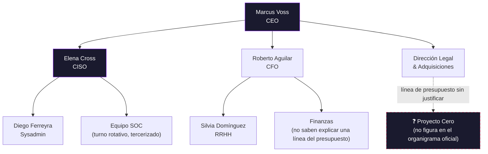

# Organigrama de HELIX Corp

*Reconstruido a partir de un export de la herramienta de RRHH que alguien dejó con permisos de lectura pública "temporalmente" en 2019 y nunca se acordó de cerrar.*

## Lectura del organigrama

- **Marcus Voss (CEO):** firma comunicados de prensa sobre "cultura de seguridad primero" y después aprueba recortes de presupuesto en el área de seguridad. Nunca lee los reportes que le mandan, pero los reenvía con "Excelente trabajo equipo 👏".
- **Elena Cross (CISO):** tiene el título, no tiene el presupuesto. Da webinars de LinkedIn sobre "Zero Trust" mientras la VPN de la empresa sigue usando una versión con CVEs de hace tres años.
- **Roberto Aguilar (CFO):** aprueba todos los presupuestos, incluido el que nadie más sabe explicar.
- **Diego Ferreyra (Sysadmin):** el único ser humano en HELIX que sabe dónde está cada servidor, cada credencial y cada cron job olvidado. Un solo punto de fallo con nombre y apellido.
- **Silvia Domínguez (RRHH):** manda más comunicados sobre el dress code que sobre políticas de contraseñas.
- **Dirección Legal & Adquisiciones:** el área que gestionó la compra que trajo, sin que nadie lo pidiera oficialmente, a **Proyecto Cero**. La línea punteada del diagrama no es un error: la relación es así de poco clara.

Más sobre cada uno en [`personajes.md`](personajes.md), y sobre lo que esconde esa línea punteada en [`../proyecto-cero/`](../proyecto-cero/).
