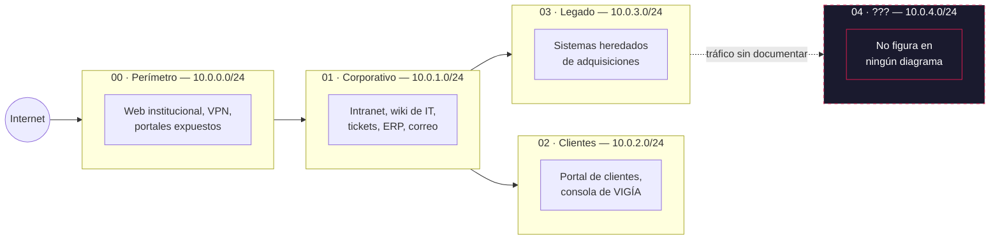

# Mapa de red de HELIX Corp

*Reconstruido por 0x0 a partir del recon inicial, los diagramas viejos de la wiki de IT y lo que no coincidía entre ambos.*

## Las zonas

| Zona | Carpeta | Dificultad | Qué hay |
| :-- | :-- | :--: | :-- |
| **00 · Perímetro** | [`red/00-perimetro/`](../red/00-perimetro/) | 🟢 | Lo que HELIX expone a internet. Configuraciones por defecto, software sin actualizar desde el día del lanzamiento. |
| **01 · Corporativo** | [`red/01-corporativo/`](../red/01-corporativo/) | 🟢 🟡 | La intranet de todos los días: RRHH, la wiki de IT, la mesa de ayuda, Finanzas. Donde trabaja la gente, y donde la gente deja cosas. |
| **02 · Clientes** | [`red/02-clientes/`](../red/02-clientes/) | 🟡 | Lo que HELIX le vende al mundo: el portal de clientes y la consola de VIGÍA. Datos reales de terceros de por medio. |
| **03 · Legado** | [`red/03-legado/`](../red/03-legado/) | 🟡 🔴 | Sistemas que llegaron con adquisiciones y nadie migró. Raros, viejos, con capas. Acá vive `reportes-legacy-02`. |
| **04 · ???** | [`red/04-proyecto-cero/`](../red/04-proyecto-cero/) | 🔴 | La subred que no está en los diagramas oficiales. Hacia acá va el tráfico que nadie sabe explicar. |

## Convenciones del mundo

Para quien explora (y para quien crea máquinas), la red de HELIX sigue siempre estas reglas:

- **Dominio:** `helixcorp.com` hacia afuera, `helixcorp.local` hacia adentro.
- **Usuarios:** `nombre.apellido` (ej. `diego.ferreyra`).
- **Direccionamiento narrativo:** `10.0.<zona>.0/24`. Es la IP "en la historia". Los contenedores corren en tu máquina con la red que defina cada `docker-compose.yml`.
- **Hora:** todo está en `-0300`.

---

> *"Los diagramas de la wiki tienen cuatro zonas. El tráfico tiene cinco. Alguien dibujó mal, o alguien no quiso dibujar."*
> — 0x0
