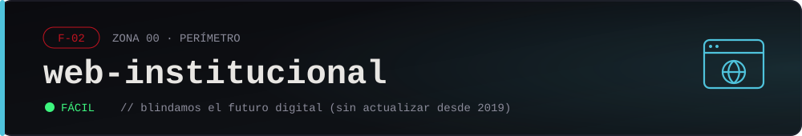

<div align="center">



| Hostname | IP narrativa | Categorías | Objetivo |
| :--: | :--: | :-- | :--: |
| `web-institucional.helixcorp.local` | `10.0.0.11` | web · CMS · subida de archivos · RCE · escalada | root → `/root/flag.txt` |

</div>

## Briefing

<div align="justify">

El sitio público de HELIX: "Blindamos el futuro digital", en letras grandes sobre fondo negro. Lo relanzaron con bombos y platillos en 2019 y desde entonces nadie volvió a tocarlo. Corre un CMS hecho en casa, de esos que alguien instaló una tarde y que todavía tiene el usuario de fábrica. La sala de prensa no publica nada nuevo desde hace años, pero el panel de atrás sigue abierto, esperando.

Una empresa que vende seguridad no actualiza ni su propia vidriera. Por algún lado hay que empezar.

</div>

> *"La página dice 'blindamos el futuro'. El futuro, no la página."*
> — 0x0

## Levantar

```bash
docker compose up -d
```

- Sitio: http://localhost:8080

Resetear: `docker compose down -v && docker compose up -d`

## Fragmento del expediente

Con la flag, desde la raíz del repo:

```bash
./herramientas/abrir-fragmento.sh red/00-perimetro/01-web-institucional 'HELIX{...}'
```

## Pistas

<details>
<summary>Pista 1</summary>

Mirá lo que el sitio pide que no mires. El `robots.txt` apunta a un par de carpetas que no deberían estar a mano — una de ellas tiene un listado abierto y guarda un respaldo viejo del sitio.

</details>

<details>
<summary>Pista 2</summary>

Dentro de ese respaldo está la configuración del CMS, con el usuario y la contraseña del panel tal como quedaron en 2019 (la misma clave que circula por toda la empresa). Con eso entrás a `/cms/`. Ahí hay un gestor de medios que dice aceptar solo imágenes… pero, ¿en qué se fija exactamente para decidir que algo es una imagen?

</details>

<details>
<summary>Pista 3</summary>

El gestor confía en el `Content-Type` que manda el navegador, no en el archivo. Subí un `.php` declarándolo `image/png` y te queda en `/uploads/`, donde Apache lo ejecuta: ahí tenés RCE como `www-data`. Para root, buscá binarios con SUID (`find / -perm -4000 -type f 2>/dev/null`): va a aparecer uno que no debería estarlo. Pasá por [GTFOBins](https://gtfobins.github.io/) a ver cómo devuelve una shell de root.

</details>
