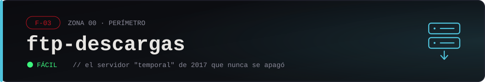

<div align="center">



| Hostname | IP narrativa | Categorías | Objetivo |
| :--: | :--: | :-- | :--: |
| `ftp-descargas.helixcorp.local` | `10.0.0.12` | FTP · WebDAV · RCE · PATH hijacking · escalada | root → `/root/flag.txt` |

</div>

## Briefing

<div align="justify">

El servidor de descargas de HELIX: instaladores y manuales del agente VIGÍA, servidos por FTP anónimo desde 2017. Lo pusieron "temporalmente" mientras migraban a algo mejor. Nueve años después sigue ahí, con una zona de subida que alguien habilitó para los partners y nunca cerró.

Nada más permanente que lo temporal. Y en una caja vieja que nadie mira, a veces quedan cosas que no deberían estar a la vista.

</div>

> *"Lo etiquetaron 'temporal' en 2017. Es lo más estable que tiene HELIX."*
> — 0x0

## Levantar

```bash
docker compose up -d
```

- Sitio (centro de descargas): http://localhost:8080
- FTP anónimo: `ftp://localhost` (modo pasivo en 30000-30009)

Resetear: `docker compose down -v && docker compose up -d`

## Fragmento del expediente

Con la flag, desde la raíz del repo:

```bash
./herramientas/abrir-fragmento.sh red/00-perimetro/02-ftp-descargas 'HELIX{...}'
```

## Pistas

<details>
<summary>Pista 1</summary>

El FTP acepta login anónimo (`anonymous`, sin contraseña). Entrá y mirá **todas** las carpetas, no solo la de descargas públicas. Hay una que es "de Sistemas" y guarda algo que quedó en el lugar equivocado.

</details>

<details>
<summary>Pista 2</summary>

El sitio web tiene una "zona de subida" (mirá el `robots.txt`). Está servida por WebDAV sin autenticación: un `OPTIONS` te muestra que el servidor habla DAV. Si podés subir un archivo con `PUT`, podés subir uno que el servidor ejecute.

```bash
curl -T shell.php http://localhost:8080/subir/shell.php
```

</details>

<details>
<summary>Pista 3</summary>

Ya con shell de `www-data`, buscá binarios con SUID (`find / -perm -4000 -type f 2>/dev/null`): hay uno casero, `respaldo-web`. Fijate con `strings` qué comando corre… y si lo llama por ruta absoluta o solo por su nombre. Si es por su nombre, vos controlás el `PATH`: plantá tu propio binario con ese nombre, poné tu carpeta primera en el `PATH` y corré el SUID.

</details>
