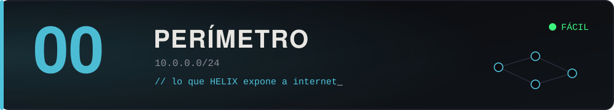

Lo que HELIX expone a internet: el sitio institucional, la VPN, los portales que alguien pidió "para ayer" y nadie volvió a tocar. Configuraciones por defecto, software sin actualizar desde el día del lanzamiento, credenciales que circulan por mail.

Es la puerta de entrada. Ideal para practicar lo básico: enumeración, servicios expuestos, credenciales débiles y primeras escaladas.

> *"Si la puerta de entrada de una empresa de seguridad se ve así, imaginate el sótano."*
> — Ceniza

## Máquinas

| # | Máquina | Dificultad | Categorías | Fragmento |
| :--: | :-- | :--: | :-- | :--: |
| 00 | [`portal-empleados`](00-portal-empleados/) | 🟢 | web · SQLi · reúso de credenciales · escalada | F-01 |
| 01 | [`web-institucional`](01-web-institucional/) | 🟢 | web · CMS · subida de archivos · RCE · escalada | F-02 |
| 02 | [`ftp-descargas`](02-ftp-descargas/) | 🟢 | FTP · WebDAV · RCE · PATH hijacking · escalada | F-03 |

Para sumar una, ver [`docs/crear-una-maquina.md`](../../docs/crear-una-maquina.md).

