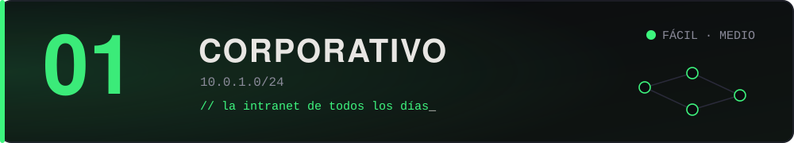

La intranet de todos los días: el autoservicio de RRHH, la wiki de IT, la mesa de ayuda, el ERP de Finanzas, el correo del directorio. Acá trabaja la gente, y la gente deja cosas: contraseñas en wikis, tickets que nadie cierra, mails reenviados con demasiada gente en copia.

Es la zona donde se empieza a ver *quién sabe algo*.

> *"Leé los tickets viejos. Las empresas no guardan secretos en los servidores, los guardan en las quejas."*
> — 0x0

## Máquinas

| Máquina | Dificultad | Categorías | Fragmento |
| :-- | :--: | :-- | :--: |
| *Todavía no hay máquinas en esta zona.* | | | |

Para sumar una, ver [`docs/crear-una-maquina.md`](../../docs/crear-una-maquina.md).

