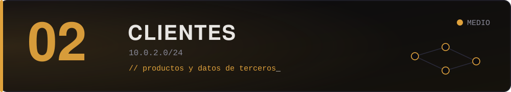

Lo que HELIX le vende al mundo: el portal donde los clientes descargan VIGÍA, la consola desde la que HELIX ve a más de mil redes ajenas, la facturación. Acá hay datos reales de terceros, integraciones que nunca se terminaron de auditar, y la primera sensación clara de que algo no cierra.

> *"Una empresa de seguridad con acceso a mil doscientas redes. Pensá en eso como atacante, no como cliente."*
> — Root

## Máquinas

| Máquina | Dificultad | Categorías | Fragmento |
| :-- | :--: | :-- | :--: |
| *Todavía no hay máquinas en esta zona.* | | | |

Para sumar una, ver [`docs/crear-una-maquina.md`](../../docs/crear-una-maquina.md).

