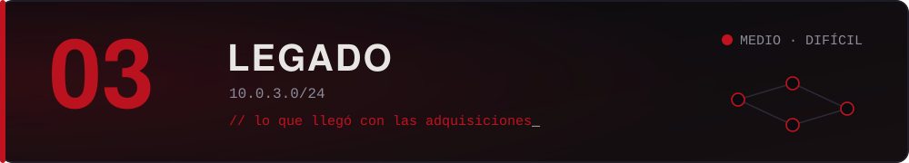

Lo que llegó con cada adquisición y nadie migró: NAS viejos, servidores con hostnames de empresas que ya no existen, servicios custom que solo entendía alguien que se fue hace años. Son sistemas raros, con capas, donde las técnicas de manual no siempre alcanzan.

Acá vive `reportes-legacy-02`, el servidor que nadie puede apagar.

> *"Lo legacy no es lo viejo. Es lo que alguien decidió no mirar."*
> — Ceniza

## Máquinas

| Máquina | Dificultad | Categorías | Fragmento |
| :-- | :--: | :-- | :--: |
| *Todavía no hay máquinas en esta zona.* | | | |

Para sumar una, ver [`docs/crear-una-maquina.md`](../../docs/crear-una-maquina.md).

