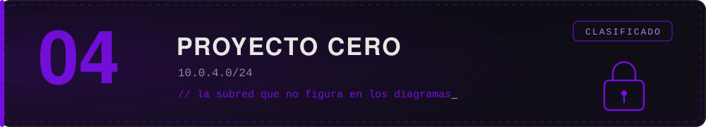

La subred que no figura en ningún diagrama. Acá no hay configuraciones por defecto ni contraseñas en wikis. Hay alguien del otro lado que sabe lo que está protegiendo, y que espera que vengas.

Cada máquina de esta zona revela una parte de lo que Proyecto Cero es realmente. Ver [`lore/proyecto-cero/`](../../lore/proyecto-cero/).

> *"Si algo en esta zona parece fácil, desconfiá. No es descuido: es una trampa."*
> — Ceniza

## Máquinas

| Máquina | Dificultad | Categorías | Fragmento |
| :-- | :--: | :-- | :--: |
| *Todavía no hay máquinas en esta zona.* | | | |

Para sumar una, ver [`docs/crear-una-maquina.md`](../../docs/crear-una-maquina.md).

