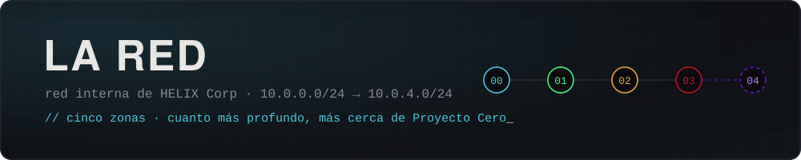

<div align="center">



</div>

<div align="justify">

Cada carpeta es una zona de la red interna de HELIX Corp, y cada subcarpeta es una máquina. Cuanto más alto el número, más profunda la zona, más difíciles las máquinas y más cerca de Proyecto Cero. El contexto de cada zona está en el [mapa de red](../lore/mapa-de-red.md).

</div>

<div align="center">

| Zona | Dificultad | Máquinas |
| :-- | :--: | :--: |
| [`00-perimetro/`](00-perimetro/) | 🟢 | 3 |
| [`01-corporativo/`](01-corporativo/) | 🟢 🟡 | 0 |
| [`02-clientes/`](02-clientes/) | 🟡 | 0 |
| [`03-legado/`](03-legado/) | 🟡 🔴 | 0 |
| [`04-proyecto-cero/`](04-proyecto-cero/) | 🔴 | 0 |

</div>

## Anatomía de una máquina

```
red/<zona>/<NN-maquina>/
├── README.md            # briefing, objetivo, cómo levantarla, pistas
├── maquina.yml          # ficha: dificultad, categorías, puertos, fragmento
├── docker-compose.yml
├── Dockerfile
├── src/                 # lo que necesite la máquina
└── fragmento.enc        # fragmento del expediente, cifrado con la flag
```

## Jugar una máquina

```bash
cd red/<zona>/<maquina>
docker compose up -d                              # levantar
docker compose down -v && docker compose up -d    # resetear
docker compose down -v                            # apagar y limpiar
```

<div align="justify">

Con la flag en mano, desde la raíz del repo:

</div>

```bash
./herramientas/abrir-fragmento.sh red/<zona>/<maquina> 'HELIX{...}'
```
